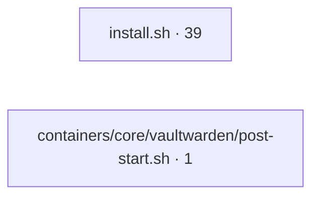
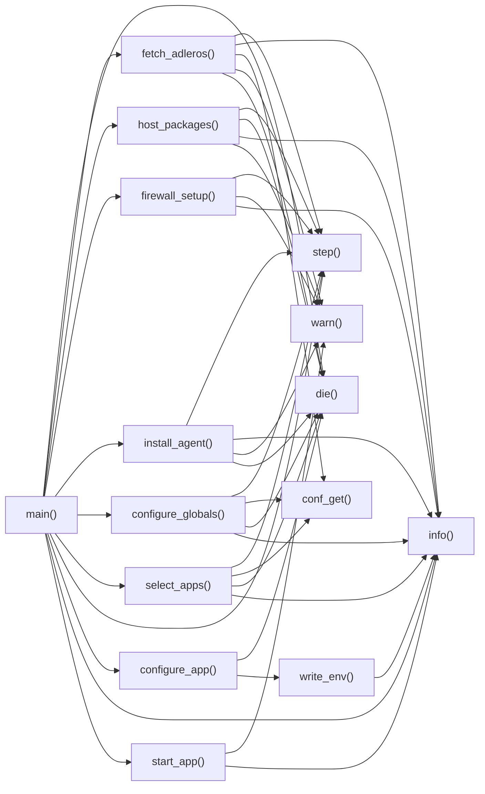

# Codemap: homelab

← [README](README.md)

> Generated from commit `789e78f` by `scripts/codemap.py`. Regenerate it from the workspace root with `python3 scripts/codemap.py homelab`; don't edit it by hand.

## Files

Each box is a source file and its function count; an arrow means calls into that file.

## Hubs

The most connected functions: where a change reaches furthest.

| Function | Where | Called by | Calls |
|---|---|---|---|
| `main()` | `install.sh:748` | 0 | 17 |
| `info()` | `install.sh:49` | 10 | 0 |
| `warn()` | `install.sh:50` | 10 | 0 |
| `die()` | `install.sh:51` | 8 | 0 |
| `select_apps()` | `install.sh:531` | 1 | 7 |
| `step()` | `install.sh:48` | 8 | 0 |
| `configure_app()` | `install.sh:653` | 1 | 6 |
| `configure_globals()` | `install.sh:436` | 1 | 6 |
| `fetch_adleros()` | `install.sh:332` | 1 | 6 |
| `firewall_setup()` | `install.sh:250` | 1 | 5 |
| `host_packages()` | `install.sh:144` | 1 | 4 |
| `install_agent()` | `install.sh:389` | 1 | 4 |
| `start_app()` | `install.sh:666` | 1 | 4 |
| `write_env()` | `install.sh:575` | 1 | 3 |
| `conf_get()` | `install.sh:99` | 3 | 0 |

## Functions

### `containers/core/vaultwarden/post-start.sh`

- `serving()` L20

### `install.sh`

- `step()` L48
- `info()` L49
- `warn()` L50
- `die()` L51
- `interactive()` L56
- `ask()` L59 → `interactive()`
- `confirm()` L66 → `interactive()`
- `env_file_set()` L77
- `set_env()` L97 → `env_file_set()`
- `conf_get()` L99
- `load_env()` L106
- `env_vars()` L118
- `gen_pass()` L120
- `fill_secrets()` L123 → `gen_pass()`
- `load_catalog()` L133
- `app_dir()` L140
- `host_packages()` L144 → `step()`, `die()`, `info()`, `warn()`
- `physical_nics()` L217
- `write_docker_user_block()` L220 → `warn()`
- `firewall_setup()` L250 → `step()`, `warn()`, `info()`, `confirm()`, `write_docker_user_block()`
- `free_dns_port()` L291 → `info()`, `warn()`
- `choose_adleros()` L316 → `confirm()`
- `fetch_adleros()` L332 → `step()`, `choose_adleros()`, `info()`, `conf_get()`, `warn()`, `die()`
- `adleros_installer()` L379 → `warn()`
- `install_agent()` L389 → `step()`, `info()`, `warn()`, `die()`
- `configure_globals()` L436 → `step()`, `conf_get()`, `ask()`, `die()`, `env_file_set()`, `info()`
- `app_menu()` L494
- `select_apps()` L531 → `step()`, `conf_get()`, `app_menu()`, `die()`, `interactive()`, `env_file_set()`, `info()`
- `make_storage()` L556 → `die()`
- `globals_block()` L565
- `write_env()` L575 → `globals_block()`, `fill_secrets()`, `info()`
- `make_mount_dirs()` L607
- `render_templates()` L617 → `env_vars()`, `load_env()`
- `run_hook()` L641 → `load_env()`
- `configure_app()` L653 → `app_dir()`, `die()`, `write_env()`, `render_templates()`, `make_mount_dirs()`, `run_hook()`
- `start_app()` L666 → `app_dir()`, `run_hook()`, `warn()`, `info()`
- `reload_nginx()` L687 → `warn()`
- `summary()` L697 → `step()`, `warn()`
- `main()` L748 → `die()`, `load_catalog()`, `fetch_adleros()`, `host_packages()`, `firewall_setup()`, `free_dns_port()`, `install_agent()`, `configure_globals()`, `select_apps()`, `make_storage()`, +7
