# A Sovereign Homelab

> Engineering a comprehensive, self-sovereign digital infrastructure architected on first principles, reclaiming data ownership through physically isolated hardware, encrypted mesh networking, and auditable Infrastructure as Code (IaC), thereby eliminating reliance on rent-seeking centralized cloud providers.


> Are you new to self hosting? **[Click here](abstract.md)** for a TL;DR!

This repository is one script and about thirty apps. It turns a Raspberry Pi
(or any 64-bit Debian or Ubuntu machine) into your own photo library, music
streamer, password manager, notes, documents, location history, finance
tracker and more. You can reach all of it from your phone and laptop
anywhere in the world, and nobody else can reach any of it.

```bash
git clone https://github.com/spaceadler/homelab ~/homelab
cd ~/homelab && ./install.sh
```

`install.sh` installs Docker and Tailscale, locks the firewall, asks which
apps you want, generates every password, and starts them. It's safe to run
again whenever you like: that's also how you add apps and apply updates. The
**[How-to-Use Guide](how-to-use.md)** walks through a first install step by
step.

## Table of Contents
1. [How it works](#how-it-works)
2. [The apps and their addresses](#the-apps-and-their-addresses)
3. [Directory structure](#directory-structure)
4. [Operating it](#operating-it)
5. [First logins](#first-logins)
6. [Security model](#security-model)
7. [HTTPS](#https)
8. [Backup & disaster recovery](#backup--disaster-recovery)
9. [Adding an app](#adding-an-app)
10. [Hardware](#hardware)
11. [Screenshots](#screenshots)

## How it works

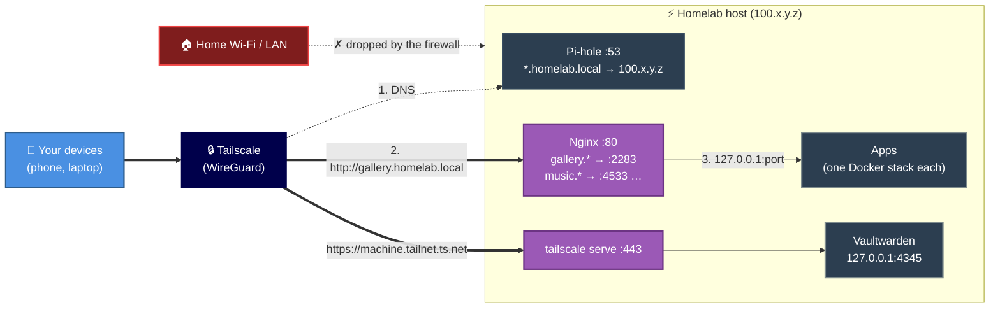

A request for `http://gallery.homelab.local` takes three hops:

1. **Name → machine.** Your device asks Pi-hole, through Tailscale's DNS
   settings, for `gallery.homelab.local`. Pi-hole has one wildcard record:
   *every* `<anything>.homelab.local` is this machine's Tailscale IP.
2. **Machine → nginx.** The browser connects to that IP on port 80, inside
   Tailscale's encrypted WireGuard tunnel.
3. **nginx → app.** nginx looks at the name, finds the site for `gallery.*`,
   and forwards to Immich on `127.0.0.1:2283`.

**Vaultwarden is the one exception.** Password managers insist on HTTPS, so
`tailscale serve` gives it a real certificate on this machine's tailnet name
([details](docs/tls.md)).

**Everything still works by port.** `http://<tailscale-ip>:2283` reaches
Immich directly. The names are a convenience, not a dependency.

**What the router and the internet see:** nothing. The router forwards no
ports, and Tailscale connects outbound. Your home Wi-Fi is also locked out:
other devices on your own network can't reach any app (see
[Security model](#security-model)).

## The apps and their addresses

Core apps are always installed; everything else you pick in
`install.sh`'s menu, by genre. Addresses below use the default domain,
`homelab.local`. **Port** is the direct `http://<tailscale-ip>:<port>`
address. This list is generated from
[`containers/catalog.tsv`](containers/catalog.tsv), which is also what the
installer reads.

#### Core (always installed)

| App | What it's for | Address | Port |
| --- | --- | --- | --- |
| Nginx | Reverse proxy: turns `<app>.<domain>` into the right port | - | 80 |
| Pi-hole | DNS for `<app>.<domain>`, plus ad blocking | `http://dns.homelab.local` | 8081 |
| Vaultwarden | Password manager | `https://<machine>.<tailnet>.ts.net` (`vault.homelab.local` redirects) | 4345 (this machine only) |

#### System

| App | What it's for | Address | Port |
| --- | --- | --- | --- |
| Glance | Start page and dashboard of every app | `http://home.homelab.local` | 8080 |
| Beszel | CPU, RAM, disk and container monitoring | `http://stats.homelab.local` | 8042 |
| Cup | Shows which container images have updates | `http://cup.homelab.local` | 9898 |

#### Photos & video

| App | What it's for | Address | Port |
| --- | --- | --- | --- |
| Immich | Photos and videos, with phone backup | `http://gallery.homelab.local` | 2283 |
| Stremio | Streaming server for the Stremio apps | `http://watch.homelab.local` | 5543 |

#### Audio

| App | What it's for | Address | Port |
| --- | --- | --- | --- |
| Navidrome | Music streaming (Subsonic apps work too) | `http://music.homelab.local` | 4533 |
| Audiobookshelf | Audiobooks, podcasts and e-books | `http://audiobook.homelab.local` | 13378 |

#### Notes

| App | What it's for | Address | Port |
| --- | --- | --- | --- |
| Globnotes | Markdown notes in storage/Notes (Obsidian-compatible) | `http://notes.homelab.local` | 8487 |
| Memos | Quick thoughts, Twitter-style | `http://memos.homelab.local` | 5230 |
| BookStack | Wiki: shelves, books, chapters, pages | `http://books.homelab.local` | 6875 |

#### Knowledge

| App | What it's for | Address | Port |
| --- | --- | --- | --- |
| Karakeep | Bookmarks that archive the page itself | `http://bookmarks.homelab.local` | 3786 |
| Kiwix | Offline Wikipedia and other .zim archives | `http://wiki.homelab.local` | 8092 |
| 4get | Private metasearch engine | `http://search.homelab.local` | 9364 |

#### Documents

| App | What it's for | Address | Port |
| --- | --- | --- | --- |
| Paperless-ngx | Scanned documents with OCR and search | `http://docs.homelab.local` | 8302 |
| CryptPad | End-to-end encrypted office suite (needs [HTTPS](docs/tls.md)) | `http://workspace.homelab.local` | 7000 |

#### Productivity

| App | What it's for | Address | Port |
| --- | --- | --- | --- |
| Vikunja | Tasks, Kanban, Gantt | `http://todo.homelab.local` | 3456 |
| Super Productivity | Time blocking and planning, synced over WebDAV | `http://schedule.homelab.local` | 5432 |
| Radicale | Calendar and contacts (CalDAV/CardDAV) | `http://cal.homelab.local` | 5222 |

#### Travel

| App | What it's for | Address | Port |
| --- | --- | --- | --- |
| Dawarich | Location history (Google Timeline replacement) | `http://timeline.homelab.local` | 3001 |
| TREK | Trip planner | `http://trips.homelab.local` | 3210 |
| AirTrail | Flight log | `http://fly.homelab.local` | 9478 |

#### Trackers

| App | What it's for | Address | Port |
| --- | --- | --- | --- |
| Yamtrack | Movies, shows, anime, books and games you've watched/read/played | `http://catalogue.homelab.local` | 2143 |
| Nomie | Life and mood tracking | `http://track.homelab.local` | 5005 |

#### Finance

| App | What it's for | Address | Port |
| --- | --- | --- | --- |
| Ghostfolio | Investment portfolio and net worth | `http://assets.homelab.local` | 3333 |
| Maybe | Budgeting and expenses | `http://budget.homelab.local` | 13400 |

#### Files

| App | What it's for | Address | Port |
| --- | --- | --- | --- |
| Syncthing | Keeps folders in sync across your devices | `http://sync.homelab.local` | 8384 |
| File Browser | Web file manager for the whole homelab folder | `http://storage.homelab.local` | 8090 |
| Gitea | Git server (SSH on port 222) | `http://git.homelab.local` | 3000 |
| qBittorrent | Torrent client, downloads to storage/Downloads | `http://qb.homelab.local` | 6420 |

A few apps answer on a second name or port as well: CryptPad's sandbox at
`workspacesb.`, Nomie's database at `trackdb.` (CouchDB, port 5984),
Stremio's streaming server on port 11470, and Gitea's SSH on port 222.

## Directory structure

The repository *is* the homelab: clone it to `~/homelab` and everything
lives inside. Files marked **(generated)** are written by `install.sh` or by
the apps themselves, are specific to your machine, and are never committed;
`.gitignore` keeps them out.

```text
~/homelab/
├── install.sh              # set up, add apps, apply changes: run it anytime
├── homelab.env.example     # template for…
├── homelab.env             # (generated) domain, timezone, storage path, your app list
├── containers/
│   ├── catalog.tsv         # every app: genre, address, port, description
│   ├── core/               # nginx · pihole · vaultwarden
│   ├── system/             # glance · beszel · cup
│   ├── photos-video/       # immich · stremio
│   ├── audio/              # navidrome · audiobookshelf
│   ├── notes/              # globnotes · memos · bookstack
│   ├── knowledge/          # karakeep · kiwix · 4get
│   ├── documents/          # paperless-ngx · cryptpad
│   ├── productivity/       # vikunja · super-productivity · radicale
│   ├── travel/             # dawarich · trek · airtrail
│   ├── trackers/           # yamtrack · nomie
│   ├── finance/            # ghostfolio · maybe
│   └── files/              # syncthing · filebrowser · gitea · qbittorrent
├── storage/                # your files, as plain folders (or STORAGE_DIR elsewhere)
│   ├── Documents/          #   Paperless-ngx archive
│   ├── Downloads/          #   qBittorrent
│   ├── Files/              #   general files
│   ├── Gallery/            #   Immich: originals, thumbnails, encoded video
│   ├── Inbox/              #   drop scans here; Paperless-ngx imports them
│   ├── Media/              #   Music, Audiobooks, Podcasts, Books, Kiwix, …
│   └── Notes/              #   Markdown notes: Globnotes, Obsidian, any editor
├── backup/containers/      # (generated) dated copies from scripts/backup.sh
├── dev/                    # your own git repositories (synced with Syncthing)
├── mailbox/                # inbox for files you haven't sorted yet
├── scripts/
│   ├── backup.sh           # Layer 1 backup (see below)
│   └── renew-certs.sh      # only for HTTPS with your own domain
└── docs/
    └── tls.md              # HTTPS: Vaultwarden by default, every app optionally
```

Your files stay plain files: no Docker volumes hide your photos or music.
If everything else breaks, plug the disk into any computer and copy
`storage/` off it.

### Inside an app folder

Every app follows the same shape. `containers/photos-video/immich/`, for
example:

```text
immich/
├── docker-compose.yml   # the recipe: images, ports, mounts, settings
├── .env.example         # its settings, with placeholders where secrets go
├── nginx.conf           # its route: server_name gallery.* → 127.0.0.1:2283
├── .env                 # (generated) globals + this app's generated secrets, chmod 600
└── postgres/            # (generated) the app's own data
```

Some apps also have a `*.template` (a config file that needs your domain,
rendered to the same name without `.template`), or a hook that
`install.sh` runs at the right moment. `configure.sh` runs on every install
(e.g. Syncthing pre-seeds its GUI login), `pre-start.sh` can hold an app
back (Kiwix waits until you have a `.zim` file), and `post-start.sh` runs
once it's up (Vaultwarden sets up `tailscale serve`).

You can work in any app folder with plain Docker Compose: every `.env`
carries the global settings too, so `docker compose up -d` there just
works.

## Operating it

Everyday commands, all run from `~/homelab`:

| To… | Run |
| --- | --- |
| Add or remove apps | `./install.sh`, then tick or untick in the menu |
| Apply a change to `homelab.env` (domain, timezone, storage path) | `./install.sh` |
| Update this repo | `git pull && ./install.sh` |
| See what's running | `docker ps`, or the Glance and Beszel dashboards |
| Read an app's logs | `cd containers/<genre>/<app> && docker compose logs -f` |
| Restart an app | `cd containers/<genre>/<app> && docker compose restart` |
| Change one app's settings | edit its `.env`, then `docker compose up -d` in its folder |
| Stop an app | `cd containers/<genre>/<app> && docker compose down` (its data stays) |
| Update one app | `cd containers/<genre>/<app> && docker compose pull && docker compose up -d` |
| Update every running app | see below |
| Find a password | `grep -h PASSWORD containers/*/*/.env` |

To update every running app in one go:

```bash
for d in containers/*/*/; do
  (cd "$d" && [ -n "$(docker compose ps -q 2>/dev/null)" ] && docker compose pull -q && docker compose up -d)
done
docker image prune -f   # clear out the old image versions
```

Cup (`cup.homelab.local`) shows which apps have updates waiting, so you can
read the changelogs first.

**How `install.sh` behaves:**

- **It doesn't prompt** with `--apps "immich memos …"` or `--yes`.
  `--apps` sets the *whole* list, so name everything you want.
- **Secrets are made once and kept.** Re-running never changes a password.
  If a newer version of the repo adds a setting to an app's `.env.example`,
  it's appended to your `.env`.
- **It never stops or deletes anything.** Unticking an app removes its
  route and dashboard entry; `docker compose down` in its folder stops it.
- **`--no-host`** skips installing packages and the firewall, for a machine
  that's already set up. **`--no-start`** writes the config without
  starting anything.

## First logins

Every app has its own accounts, on top of Tailscale. Most work the same way:
on your first visit, you create the first account and it becomes the admin.
Do that before you share your tailnet with anyone. The exceptions:

| App | First login |
| --- | --- |
| Vaultwarden | Sign-ups are off. Open `/admin` with `VAULTWARDEN_ADMIN_TOKEN` from its `.env`, invite your email, then register with it. Afterwards, empty the token in `.env` and `docker compose up -d` to close `/admin`. |
| Pi-hole | `PIHOLE_PASSWORD` |
| Paperless-ngx | `PAPERLESS_ADMIN_USER` / `PAPERLESS_ADMIN_PASSWORD` |
| File Browser | `admin` / `FILEBROWSER_ADMIN_PASSWORD` (reset to this on every start, so change it in `.env`) |
| Syncthing | `SYNCTHING_GUI_USER` / `SYNCTHING_GUI_PASSWORD` |
| Radicale | `RADICALE_USER` / `RADICALE_PASSWORD` |
| Super Productivity sync | `WEBDAV_USERNAME` / `WEBDAV_PASSWORD`, under Settings → Sync → WebDAV |
| Nomie's database | `admin` / `NOMIE_COUCHDB_PASSWORD`, under Settings → Storage → CouchDB |
| Dawarich | Creates an admin `demo@dawarich.app` on first start; its post-start hook replaces the public default password with `DAWARICH_ADMIN_PASSWORD`. Change the email once you're in. |
| BookStack | **Its built-in default: `admin@admin.com` / `password`. Change both right away.** |
| qBittorrent | User `admin` with a temporary password, which `install.sh` prints after the first start. |
| Gitea | Shows an installer on first visit; the defaults are fine. |
| Globnotes | No login by default, because being on your tailnet is the login. Set `GLOBNOTES_AUTH_TYPE=password` in its `.env` to add one. |

Each value lives in that app's `.env`, e.g.
`containers/documents/paperless-ngx/.env`.

## Security model

The goal: the homelab must not be reachable from the internet or from your
home network, only from devices on your tailnet.

- **The router forwards no ports.** Tailscale makes outbound connections
  and punches through NAT, so there's nothing to forward.
- **The firewall blocks the LAN.** `install.sh` sets up two things. First,
  ufw denies every incoming connection on the physical network cards
  (`eth0`, `wlan0`, …), which covers services running on the host.
  Second, ports published by Docker containers skip ufw's rules entirely
  (Docker routes them through its own forwarding chain), so it adds a rule
  to Docker's `DOCKER-USER` chain that drops new connections from those
  same cards. Together they mean: from the LAN, nothing answers; over
  `tailscale0`, everything does. Re-run `install.sh` after adding a
  network card.
- **Your tailnet is the key.** With Tailscale's default policy, every
  member of your tailnet can reach every port on this machine. If you
  invite friends or family, write an access policy in the
  [Tailscale admin console](https://login.tailscale.com/admin/acls) that
  grants each person only the apps they use. Also turn on device approval
  and Tailnet Lock, so a stolen login can't add a new device.
- **Secrets are unique to each install.** Every password and key is
  generated on your machine by `openssl`. They live in each app's `.env`
  (`chmod 600`) and are never committed. Where an upstream compose file
  ships a public default (Dawarich's `SECRET_KEY_BASE=CHANGE_ME`, Maybe's
  sample key), this repo makes the value required and generates it.
- **Vaultwarden is HTTPS-only.** It's bound to `127.0.0.1`, reachable only
  through `tailscale serve` (or nginx in HTTPS mode), and sign-ups are off.

Things to know, so nothing surprises you:

- **Some containers can control Docker.** Glance, Cup and the Beszel agent
  mount `/var/run/docker.sock` to show your containers. Docker's API has no
  read-only mode, so each of them could control Docker if it were
  compromised. Leave out an app you don't need.
- **Two apps see the whole homelab folder.** Syncthing and File Browser
  see all of `~/homelab`, including every `.env`. That's what lets you
  sync or browse anything, but it also means a Syncthing share of the
  repo's root sends your secrets to that device. Share subfolders (like
  `storage/`) instead, or add `**/.env` to `.stignore`.
- **`scripts/backup.sh` copies secrets too.** Its copies include every
  `.env`, so treat wherever the backups go as holding the keys to the lab.

## HTTPS

Plain HTTP on the tailnet is already encrypted, because it runs inside
WireGuard. HTTPS adds the browser padlock, which a few apps need:

- **Vaultwarden** gets HTTPS by default, through `tailscale serve` and a
  real certificate for your machine's tailnet name. You enable HTTPS
  certificates once in the Tailscale admin console.
- **Every app** can get HTTPS with your own domain and a wildcard Let's
  Encrypt certificate, issued through DNS, so no port is opened and no
  record is published. Put the certificate in
  `containers/core/nginx/letsencrypt/` and `install.sh` switches every app,
  setting and redirect over to HTTPS.

Step-by-step for both: **[docs/tls.md](docs/tls.md)**.

## Backup & disaster recovery

A 3-2-1 strategy: three copies, on two kinds of storage, one of them
off-site.

1. **Layer 1: application backup.** `sudo ./scripts/backup.sh` stops every
   running stack, copies `containers/` (configs, `.env` secrets and app
   databases) to `backup/containers/<date>/` with exact permissions, and
   starts them again. Stopping is what makes the database copies
   consistent, so the lab is briefly offline; run it at a quiet hour (e.g.
   from root's crontab).
2. **Layer 2: local sync (hot storage).** Syncthing mirrors `storage/`,
   `backup/`, `dev/` and `mailbox/` to another machine at home, as they
   change.
3. **Layer 3: encrypted cloud (cold storage).** That machine uploads the
   synced folders, container backups included, to a zero-knowledge cloud
   (Filen), encrypted before they leave.

**Recovering on a new machine** (about an hour, most of it copying):

```bash
# 1. Fresh 64-bit Raspberry Pi OS / Debian / Ubuntu, then:
git clone https://github.com/spaceadler/homelab ~/homelab
# 2. Put your files back: storage/ from Syncthing or Filen, and the latest
#    container backup over containers/:
sudo rsync -a ~/backup-copy/containers/<date>/ ~/homelab/containers/
# 3. Run the installer. It keeps the restored .env files (your passwords)
#    and picks up the new machine's Tailscale IP.
cd ~/homelab && ./install.sh
```

## Adding an app

1. **Add a row** to `containers/catalog.tsv`: genre, folder name,
   subdomain, port, icon, display name, one-line description.
2. **Create `containers/<genre>/<app>/` with:**
   - `docker-compose.yml`. Use `${PUID}`, `${PGID}`, `${TZ}`,
     `${DOMAIN}`, `${URL_SCHEME}`, `${STORAGE_DIR}`, `${HOMELAB_DIR}` and
     `${TS_IP}` from the globals. Write `${VAR:?run ./install.sh}` for
     anything required, so a missing value fails loudly instead of
     becoming empty. The rule for storage: anything you'd lose goes in a
     `./folder`, which backups copy and you can move to a new machine.
     Things the app rebuilds by itself (caches, Redis job queues, search
     indexes, downloaded models) go in Docker volumes, so they don't
     bloat the backups.
   - `.env.example`. Secrets are placeholders that `install.sh` fills in
     once: `__PASS__` (32 letters and digits), `__HEX32__`, `__HEX64__`,
     `__HEX128__`, and `__B64_32__`.
   - `nginx.conf`, a `server` block with `include snippets/listen.conf;`,
     `server_name <subdomain>.*;` and a `location /` that proxies to
     `127.0.0.1:<port>` with `include snippets/proxy.conf;`. Copy any
     app's.
   - **Optionally**, `*.template` files and `configure.sh` /
     `pre-start.sh` / `post-start.sh` hooks. Hooks run from the app folder
     with its `.env` loaded, plus `$DOCKER`, `$HOMELAB_APPS`,
     `$HOMELAB_CATALOG`, `$HOMELAB_SITES` and a `set_env KEY VALUE`
     helper. `pre-start.sh` exiting with 10 means "don't start this yet".
3. **If the app ships extra static config,** whitelist it in
   `.gitignore`. Everything else in an app folder is ignored by design.
4. **Test it:** `./install.sh --apps "<everything you run> <app>"`.

<details>
  <summary>Hardware</summary>

## Hardware

The reference machine is a Raspberry Pi 4 Model B (8 GB). It's chosen for
its balance of power draw and I/O, though any 64-bit x86 machine works just
as well.

| Component | Specification | Purpose & Justification |
| --- | --- | --- |
| **Compute Node** | Raspberry Pi 4 Model B | The **8GB RAM** variant handles the memory-hungry apps (Immich's machine learning especially). |
| **Primary Storage** | 1TB SSD (SATA via USB 3.0) | Holds the OS, the apps and every file. Replaces the MicroSD card to avoid corruption. |
| **Boot Media** | USB MSD | Boots straight from the SSD (EEPROM `BOOT_ORDER=0xf41`), bypassing the SD card. |
| **Power** | USB-C Supply | A stable 5.1V/3A supply prevents SSD brownouts. |
| **Network** | Gigabit Ethernet | Wired to the router for streaming and large transfers. |

The Pi-specific preparation (USB boot, zram and swap) is in the
[How-to-Use Guide](how-to-use.md#1-prepare-the-machine).

</details>

<details>
  <summary>Screenshots</summary>

## Screenshots

### Tailscale
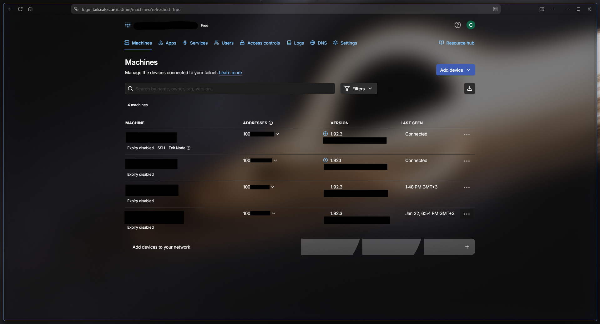

### Pi-hole
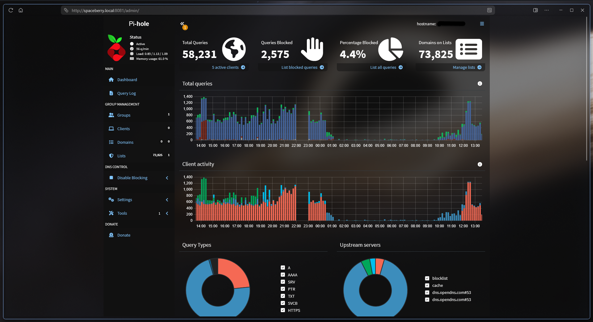

### Glance
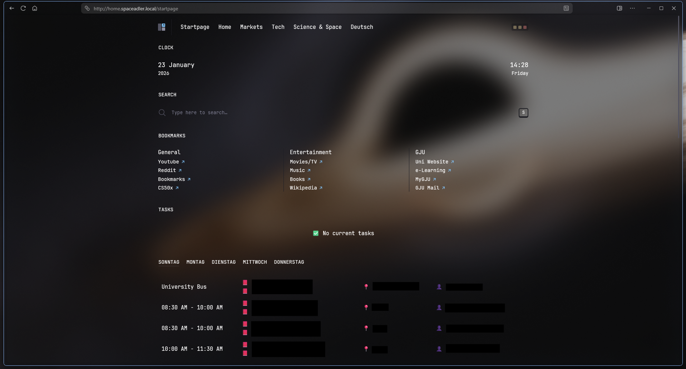

### Beszel
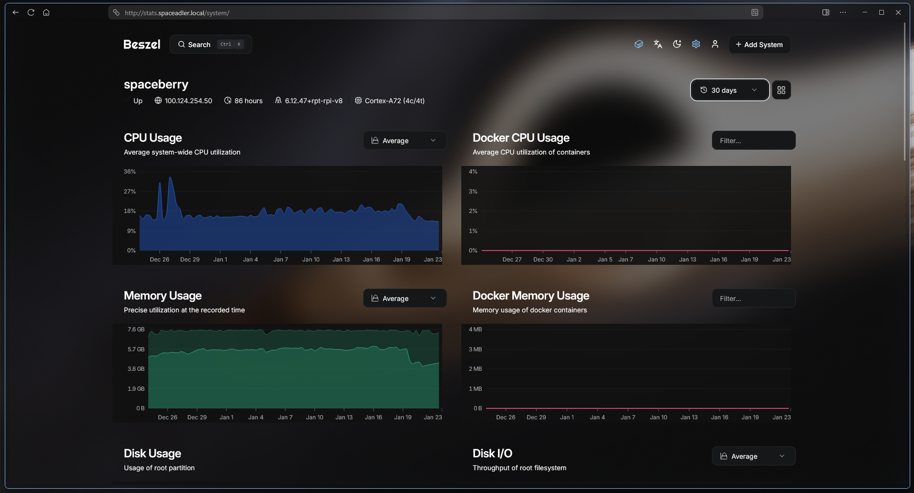

### Cup
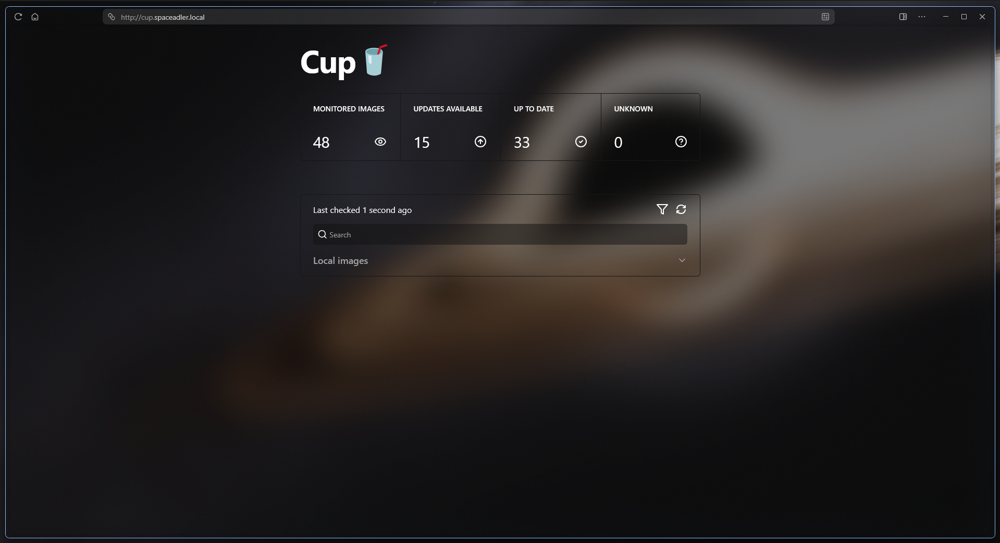

### Immich
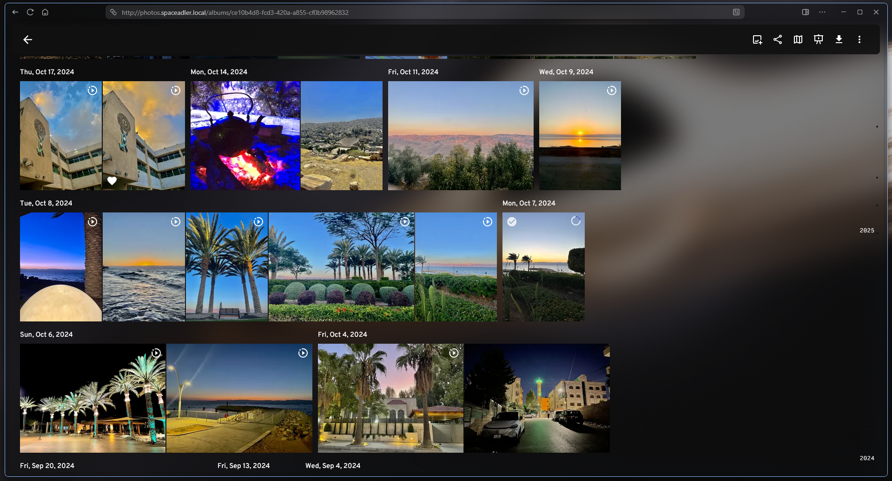

### Navidrome
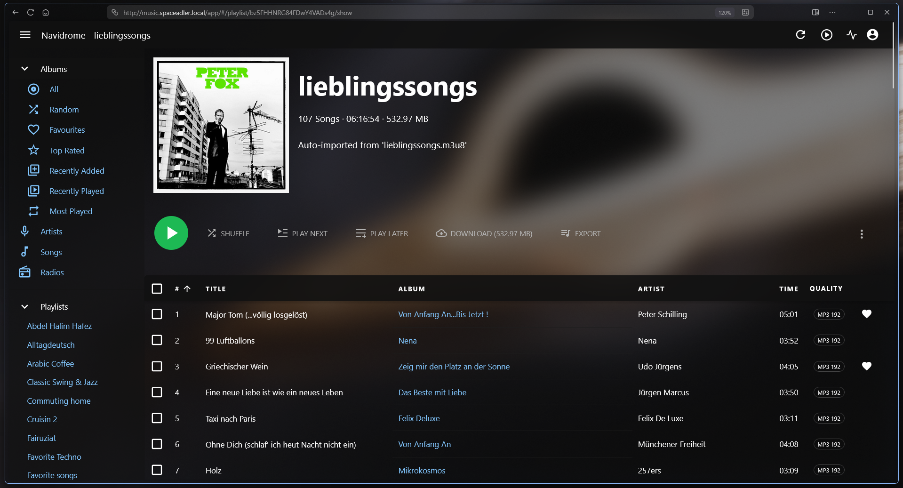

### Stremio
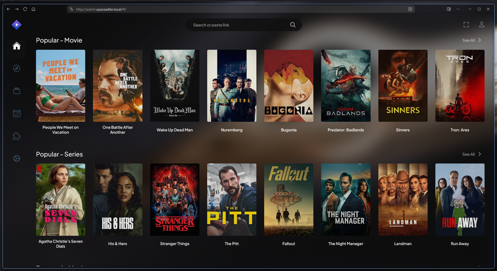

### Memos
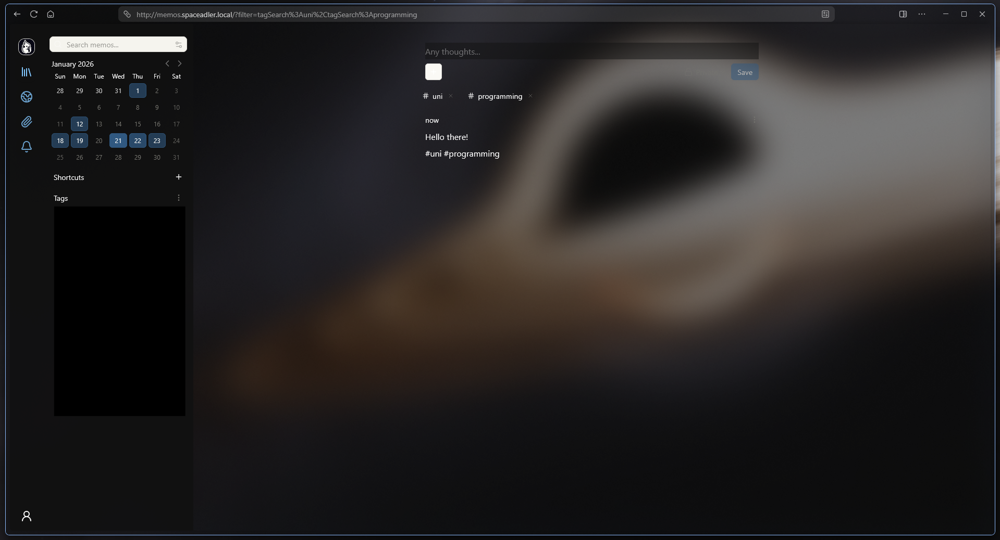

### Vikunja
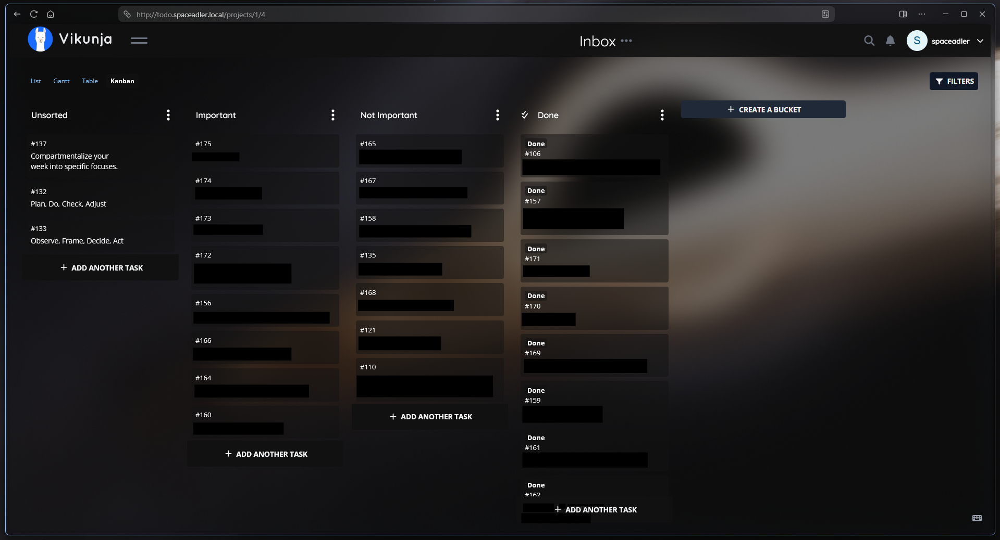

### Ghostfolio
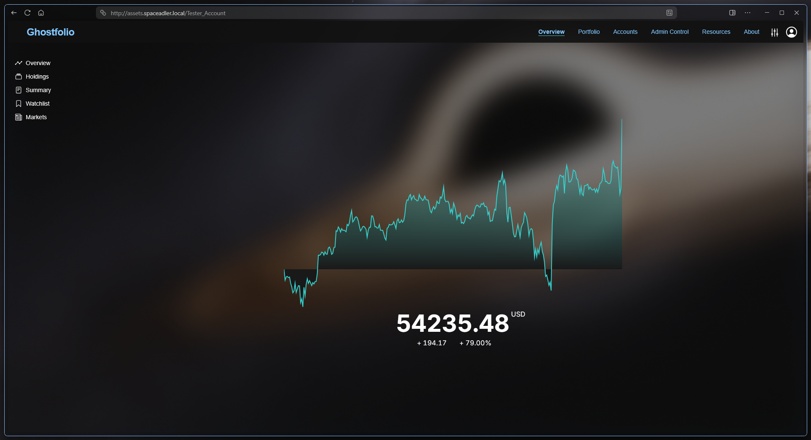

### Maybe
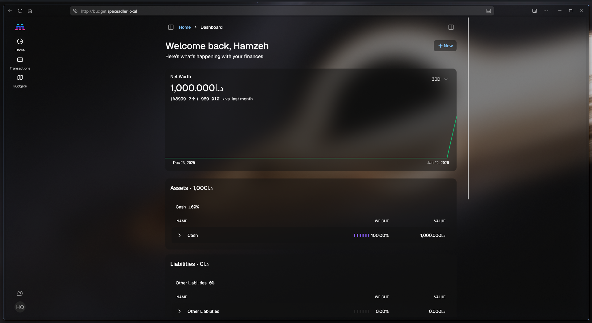

### File Browser
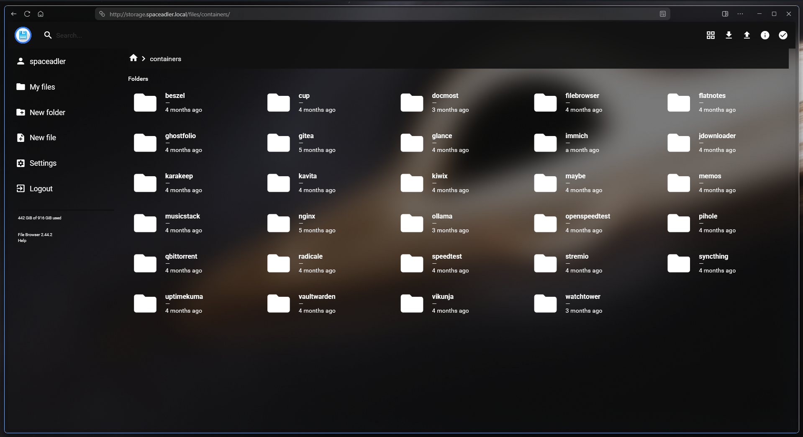

### Syncthing
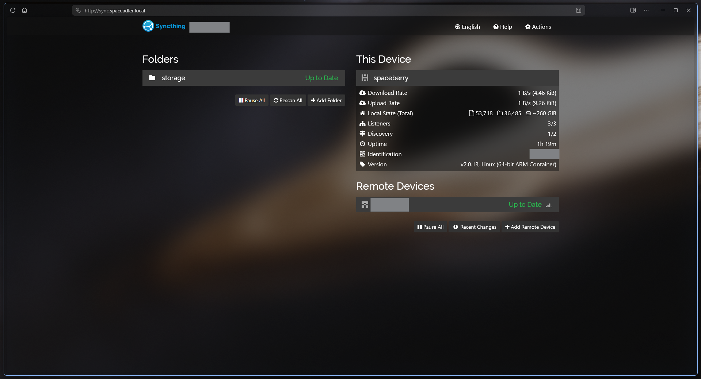

### qBittorrent
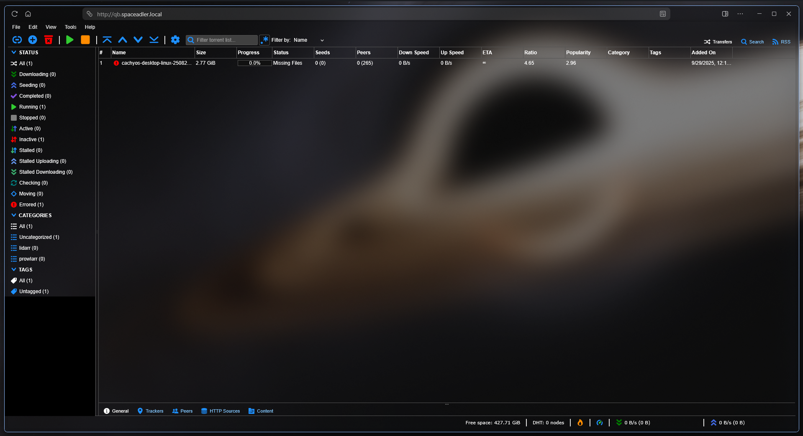

</details>

---

*powered by logic, coffee, and many sleepless nights*
