# A Sovereign Homelab

> One script and ~30 apps that turn a Raspberry Pi (or any 64-bit Debian/Ubuntu box) into your own cloud: reachable from your devices anywhere, by nobody else.


New to self-hosting? Read the **[TL;DR](abstract.md)**. Installing for the first time? Follow the **[How-to-Use Guide](how-to-use.md)**.

## Quick Start

```bash
git clone https://github.com/spaceadler/homelab ~/homelab
cd ~/homelab && ./install.sh
```

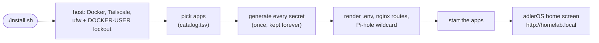

Run it again anytime: it's how you add apps, apply settings and update. It never stops or deletes anything.

## How It Works

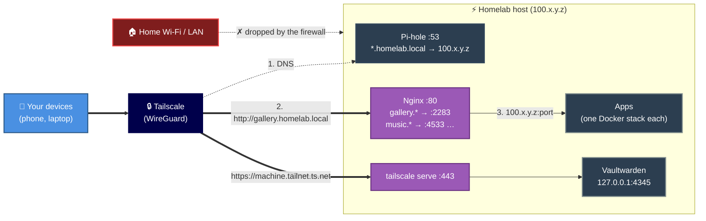

1. **Name → machine:** Pi-hole's one wildcard record sends every `*.homelab.local` to this machine's Tailscale IP.
2. **Machine → nginx:** port 80, inside the WireGuard tunnel.
3. **nginx → app:** matched by name, forwarded to the app's port. `http://<tailscale-ip>:<port>` works too.

**Vaultwarden** is the exception: it gets real HTTPS through `tailscale serve`. **The router forwards no ports**, and the home LAN is firewalled out.

## The Apps

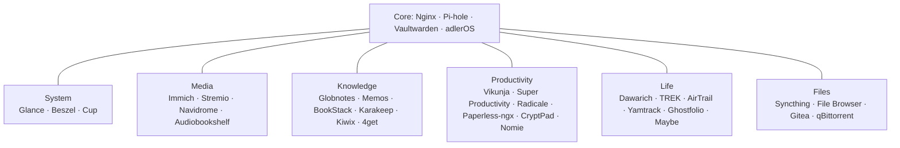

Core is always installed; the rest you pick by genre. Every address, port and first login: **[docs/apps.md](docs/apps.md)**. The source of truth is [`containers/catalog.tsv`](containers/catalog.tsv).

## The Home Screen

`http://homelab.local` opens **[adlerOS](https://github.com/spaceadler/adleros)**, styled after umbrelOS: app pages per collection, widgets, a dock, search, Files, Live Usage, Settings and an App Store, all keyboard-drivable. It's **its own repo**: `install.sh` only fetches it into `containers/core/os/adleros/` and runs its installer. Skip it with `--no-adleros`.

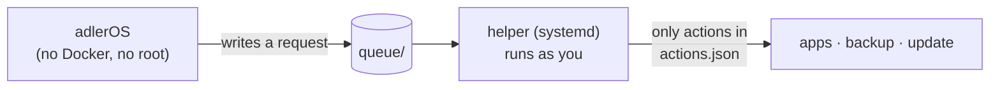

A compromised home screen can only *ask* for one of those listed actions.

## Layout

```text
~/homelab/
├── install.sh          # set up, add apps, apply changes: run it anytime
├── homelab.env         # (generated) domain, timezone, storage path, app list
├── containers/         # catalog.tsv + one folder per app, by genre
├── storage/            # your files as plain folders: no hidden volumes
├── backup/             # (generated) dated copies from scripts/backup.sh
├── dev/ · mailbox/     # your repos · your unsorted-files inbox
├── scripts/            # backup.sh, renew-certs.sh, agent/actions.json
└── docs/
```

## Documentation

| Doc | What's in it |
|---|---|
| [docs/apps.md](docs/apps.md) | Every app's address and port, and how to log in the first time |
| [docs/operating.md](docs/operating.md) | Full directory tree, everyday commands, `install.sh` flags, Settings, the helper, the App Store |
| [docs/security.md](docs/security.md) | The security model and what to watch out for |
| [docs/tls.md](docs/tls.md) | HTTPS: Vaultwarden by default, every app with your own domain |
| [docs/backup.md](docs/backup.md) | 3-2-1 backup with Syncthing and an encrypted cloud; recovering on a new machine |
| [docs/adding-an-app.md](docs/adding-an-app.md) | The app-folder contract |
| [docs/hardware.md](docs/hardware.md) | The reference Raspberry Pi 4 build |
| [CODEMAP.md](CODEMAP.md) | Files, hub functions and the call graph, generated from the code |

<details>
  <summary>Screenshots</summary>

### Tailscale
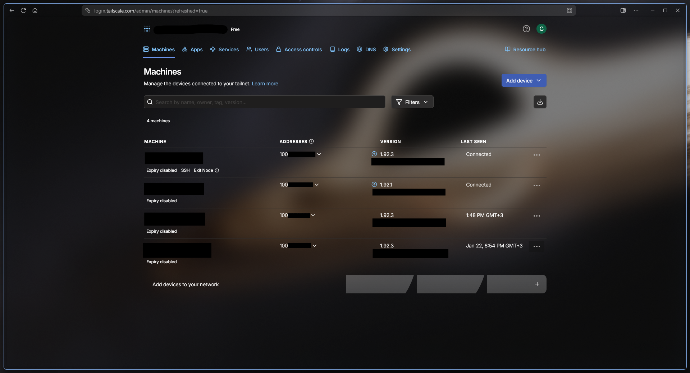

### Pi-hole
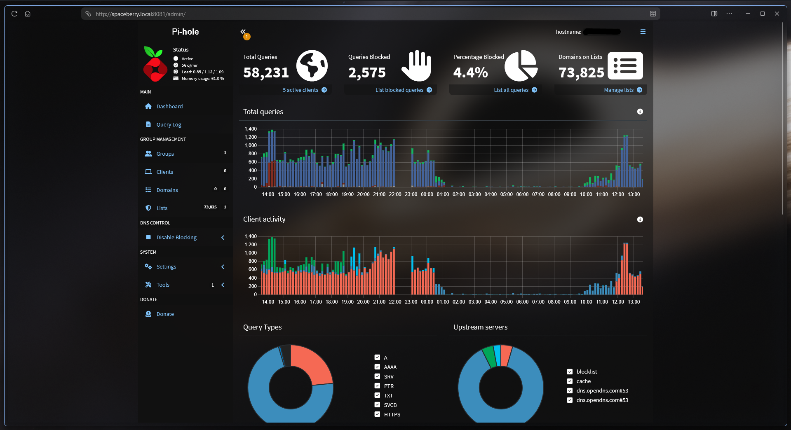

### Glance
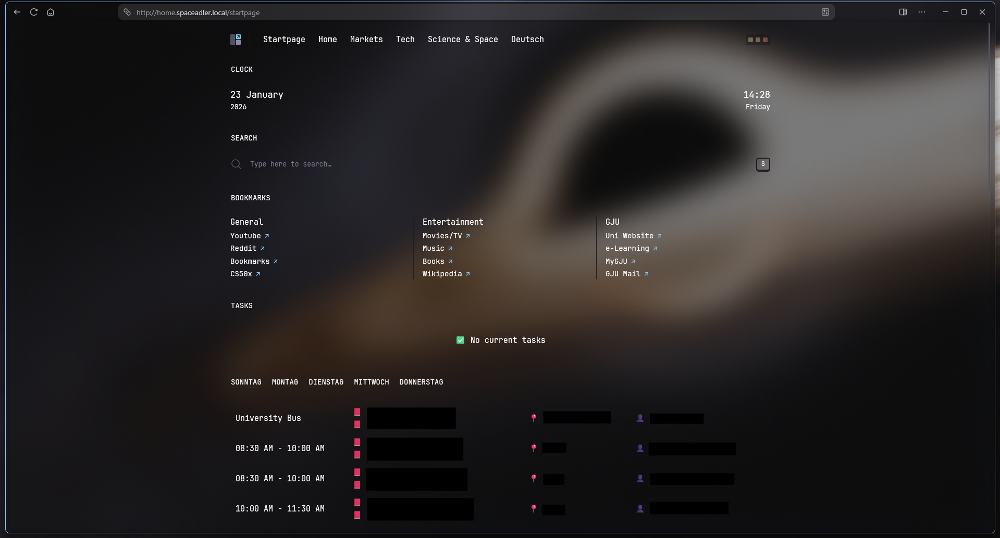

### Beszel
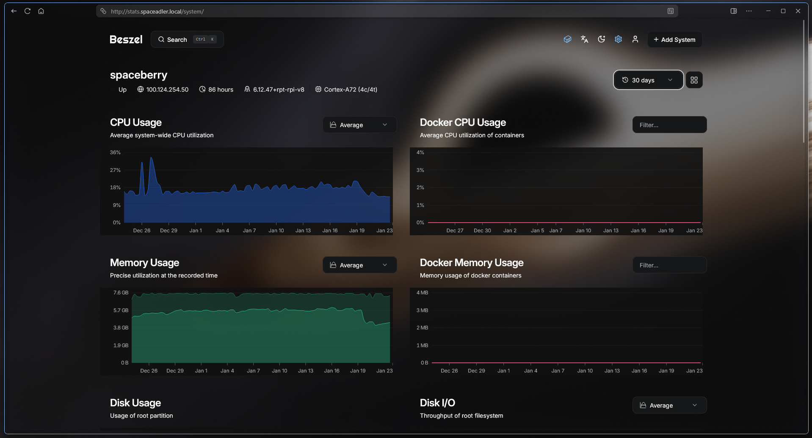

### Cup
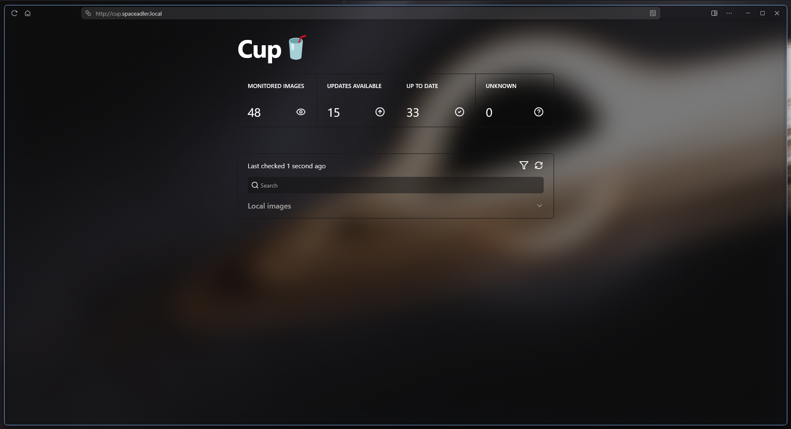

### Immich
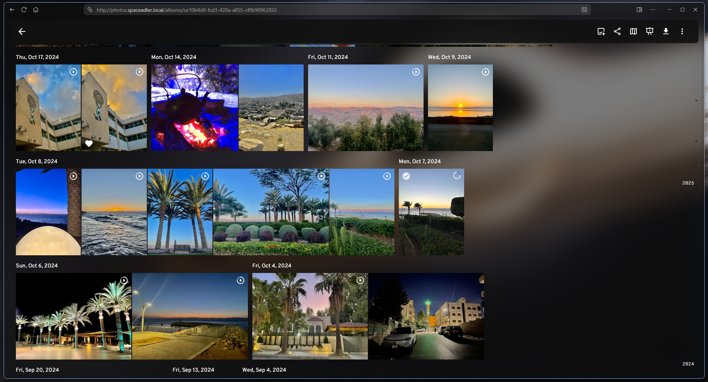

### Navidrome
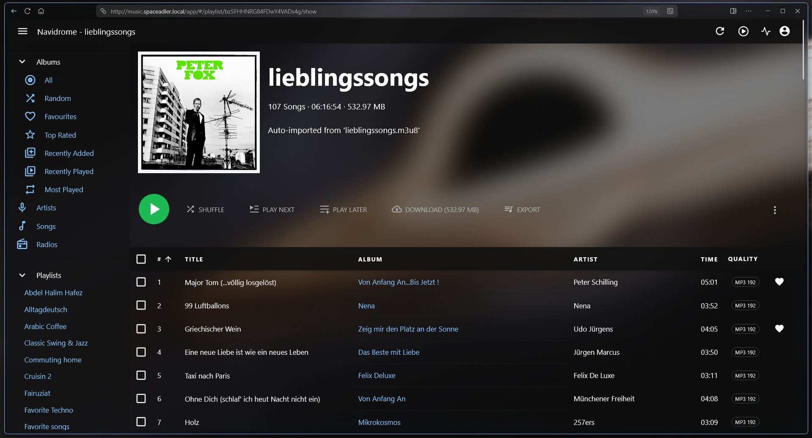

### Stremio
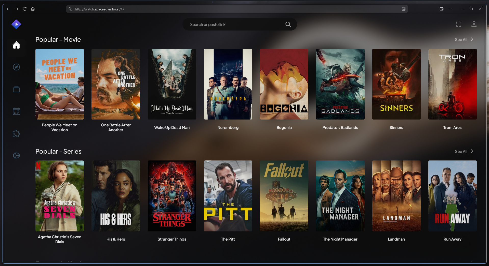

### Memos
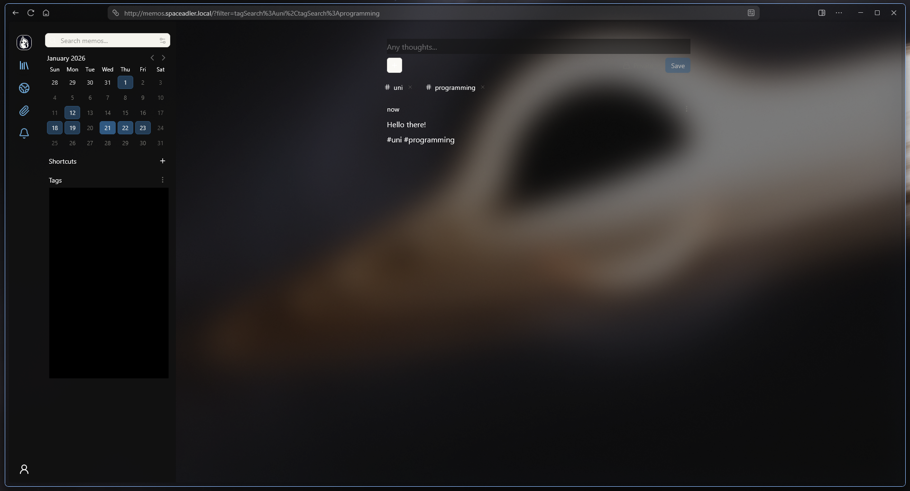

### Vikunja
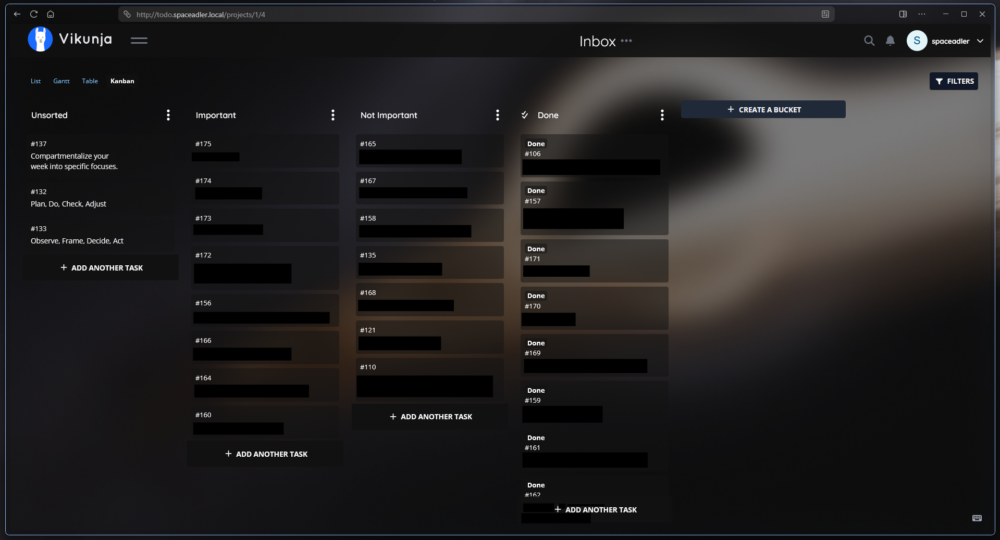

### Ghostfolio
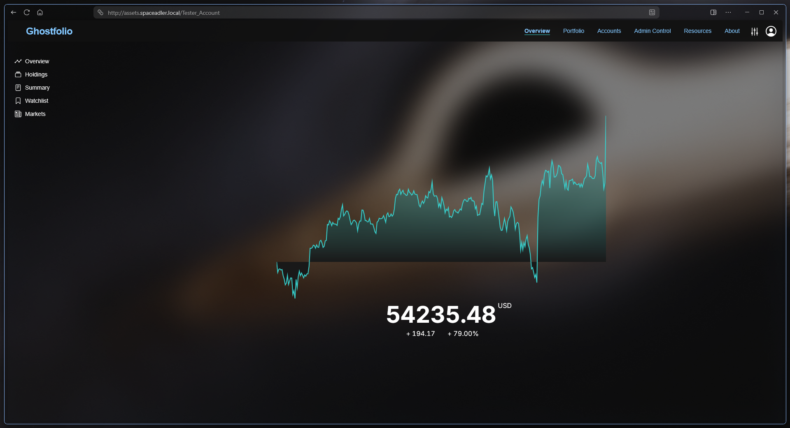

### Maybe
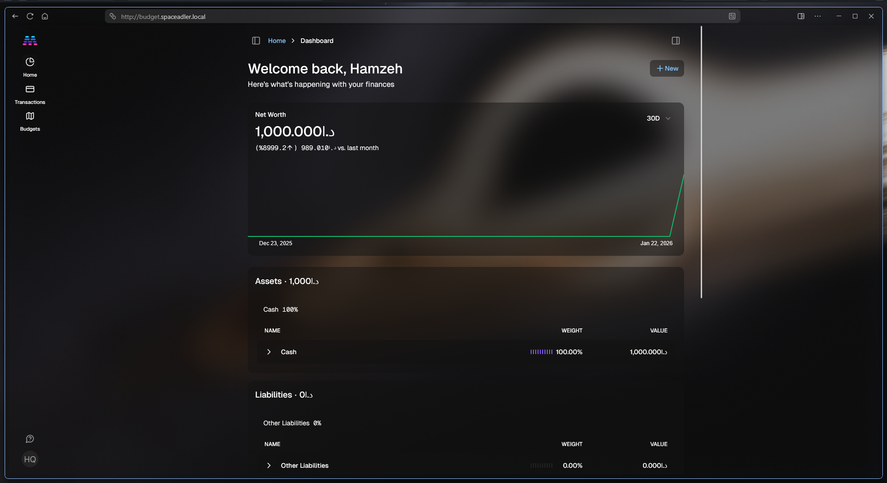

### File Browser
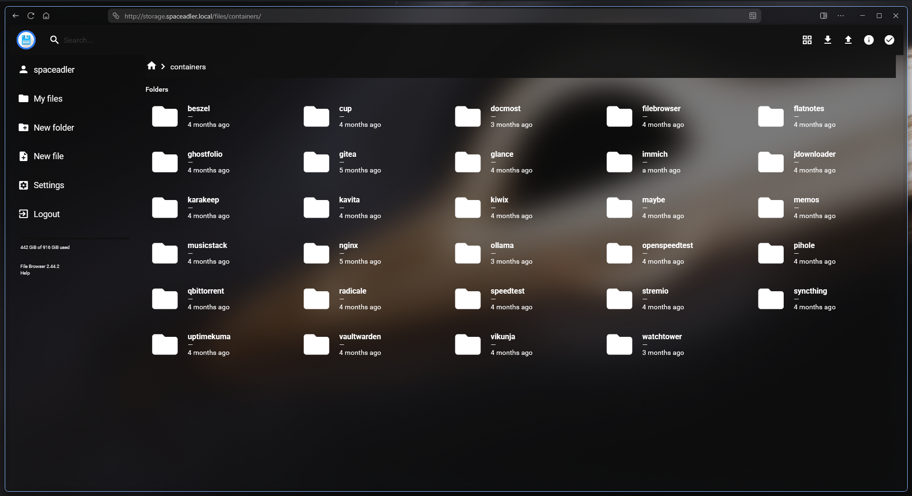

### Syncthing
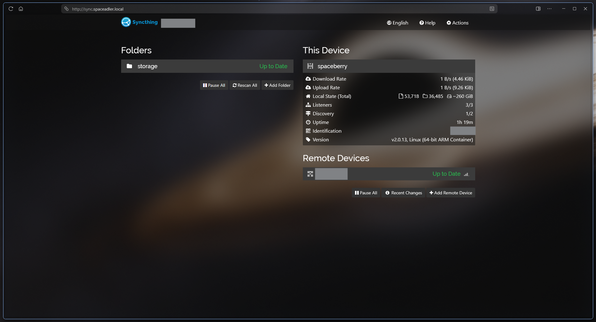

### qBittorrent
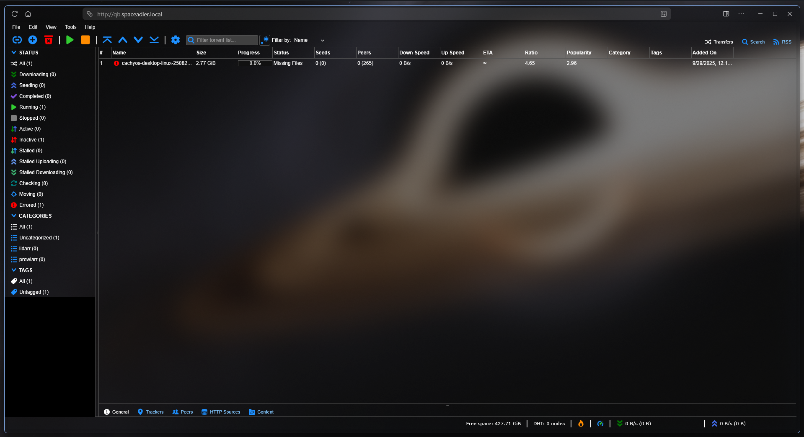

</details>

## Credits

- **Home screen:** [adlerOS](https://github.com/spaceadler/adleros), which credits its design (after umbrelOS, reimplemented, no umbrelOS code or artwork), its font (Inter, SIL OFL) and its wallpapers (NASA, public domain).
- **App icons:** fetched at runtime from [dashboard-icons](https://github.com/homarr-labs/dashboard-icons). Each icon belongs to its app's project.

---
*powered by logic, coffee, and many sleepless nights*
